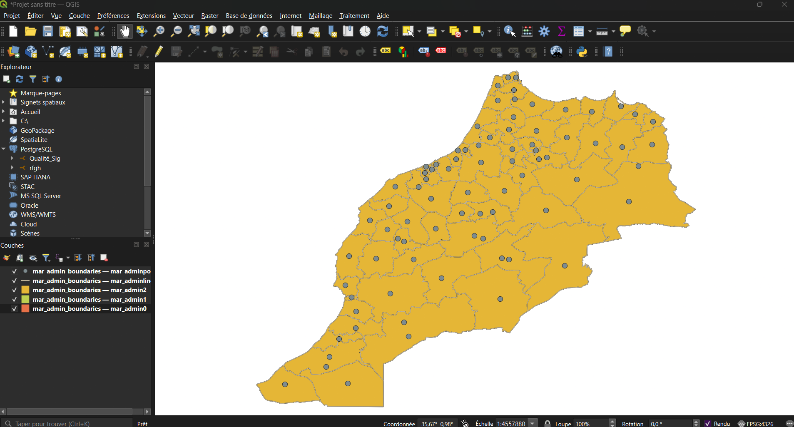

# Phase 0 — Cadrage du défi spatial et audit des sources (Séance 2)

## 1. Objectif de la phase

Définir la question spatiale métier, identifier les utilisateurs cibles, délimiter l'emprise d'étude (région **Casablanca-Settat**, code HCP `06`, 153 communes) et auditer la disponibilité réelle, la licence et le système de coordonnées de chacune des **5 sources de données** requises.

> **Défi spatial :** *Quelles zones de la région Casablanca-Settat sont mal desservies en établissements de santé, et où faut-il intervenir en priorité ?*

---

## 2. Livrables de la Phase 0

| Livrable | Fichier | Description |
|---|---|---|
| **Catalogue et audit des sources** | [`SOURCES.md`](SOURCES.md) | Détail des 5 sources (URL, millésime, licence, CRS d'origine, emprise, volume, limites connues) |
| **Rapport initial de test d'accès** | [`preuves/rapport_acces_initial.md`](preuves/rapport_acces_initial.md) | Premier diagnostic des API (Overpass, WorldPop, HDX, HCP) ayant motivé l'architecture de collecte robuste de la Phase 1 |
| **Requête Overpass d'échantillonnage** | [`preuves/osm_requete.overpassql`](preuves/osm_requete.overpassql) | Requête Overpass QL initiale pour les équipements de santé |
| **Échantillon GeoJSON (santé OSM)** | [`preuves/osm_sante_echantillon.geojson`](preuves/osm_sante_echantillon.geojson) | Extrait initial de validation (2 360 entités sur la bbox en `EPSG:4326`) |
| **Extrait raster WorldPop 100 m** | [`preuves/worldpop_casablanca_settat.tif`](preuves/worldpop_casablanca_settat.tif) | Découpe initiale du raster WorldPop 2020 Constrained sur la région |
| **Exploration visuelle initiale** | [`preuves/capture_exploration_initiale.png`](preuves/capture_exploration_initiale.png) | Capture de vérification des premières couches collectées |

---

## 3. Synthèse des 5 sources retenues

| # | Donnée | Source | Format brut | CRS brut → cible | Licence |
|---|---|---|---|---|---|
| 1 | Limites administratives (153 communes, 9 provinces) | OpenStreetMap (`admin_level=8`, tag `ref:MA:HCP`) | JSON Overpass → GeoPackage | `EPSG:4326` → `EPSG:26191` | ODbL 1.0 |
| 2 | Établissements de santé (hôpitaux, cliniques, médecins, pharmacies…) | OpenStreetMap (API Overpass) | JSON Overpass → GeoPackage | `EPSG:4326` → `EPSG:26191` | ODbL 1.0 |
| 3 | Réseau routier régional | OpenStreetMap (extrait national Geofabrik) | Shapefile → GeoPackage | `EPSG:4326` → `EPSG:26191` | ODbL 1.0 |
| 4 | Population maillée à 100 m (2020) | WorldPop (`mar_ppp_2020_constrained.tif`) | GeoTIFF | `EPSG:4326` → `EPSG:26191` | CC BY 4.0 |
| 5 | Population légale RGPH 2024 | Haut-Commissariat au Plan (HCP) | PDF → CSV structuré | Tabulaire (jointure `code_hcp`) | Ouverte (citation HCP) |

---

## 4.Aperçu de l'exploration initiale

