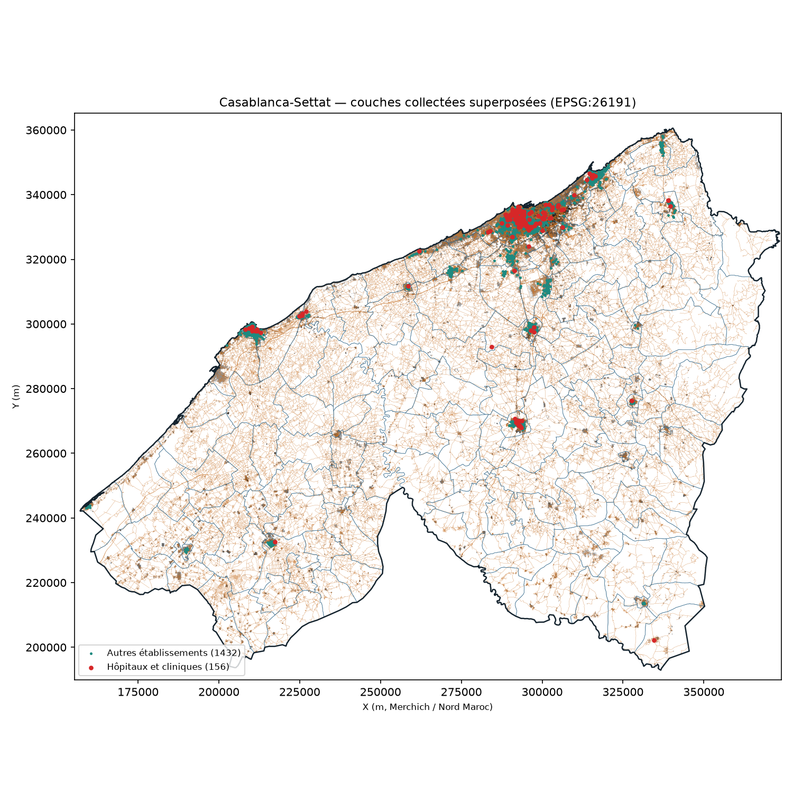
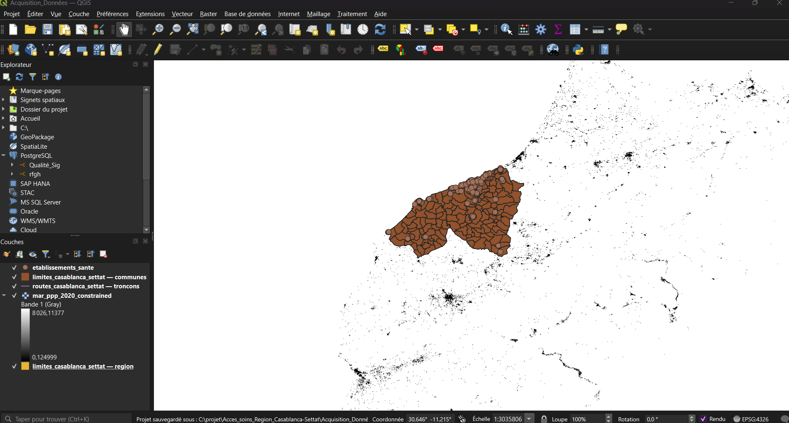

# Phase 1 — Acquisition et collecte reproductible (Séance 3)

## 1. Objectif de la phase

Automatiser la collecte multi-sources de manière **100 % reproductible**, découper toutes les données sur le polygone exact de la région Casablanca-Settat (union des 153 communes), harmoniser l'ensemble des couches dans le système de projection métrique officiel du Nord Maroc (**`EPSG:26191` — Merchich / Nord Maroc**), calculer les empreintes `SHA-256` de provenance et valider automatiquement l'intégrité des données collectées.

---

## 2. Livrables de la Phase 1

| Catégorie | Fichier | Description |
|---|---|---|
| **Support de présentation (Séance 3)** | [`presentation/seance3_acquisition.pdf`](presentation/seance3_acquisition.pdf) | Présentation complète de la séance 3 (PDF + source Beamer [`.tex`](presentation/seance3_acquisition.tex)) |
| **Script de collecte multi-sources** | [`scripts/collecte.py`](scripts/collecte.py) | Téléchargement résilient (serveurs Overpass miroirs, téléchargement partiel HTTP Range Geofabrik, WorldPop, extraction PDF HCP), découpage régional et reprojection `EPSG:26191` |
| **Configuration centralisée** | [`scripts/config.py`](scripts/config.py) | Paramètres d'emprise, CRS `EPSG:26191`, URLs des sources et gestion automatique `PROJ_LIB`/`GDAL_DATA` |
| **Contrôle automatique post-collecte** | [`scripts/controle_collecte.py`](scripts/controle_collecte.py) | Vérifie CRS, absence de géométries vides, couverture des 153 communes, jointure HCP 153/153 et génère le rapport |
| **Génération du projet QGIS** | [`scripts/creer_projet_qgis.py`](scripts/creer_projet_qgis.py) | Génère automatiquement le projet QGIS [`preuves/verification_couches_26191.qgz`](preuves/verification_couches_26191.qgz) |
| **Manifeste & traçabilité SHA-256** | [`donnees_brutes_provenance/manifest.json`](donnees_brutes_provenance/manifest.json) | Empreintes SHA-256, dates d'acquisition, URLs et métadonnées (voir aussi [`donnees_brutes_provenance/README.md`](donnees_brutes_provenance/README.md)) |
| **Données RGPH 2024 extraites** | [`donnees_brutes_provenance/tableaux_bruts_region.csv`](donnees_brutes_provenance/tableaux_bruts_region.csv) | 255 lignes du tableau officiel HCP (153 communes, 9 provinces, 7 688 967 habitants) |
| **Rapport de contrôle** | [`preuves/controle_collecte.md`](preuves/controle_collecte.md) | Bilan chiffré de validation des 5 sources en `EPSG:26191` |
| **Cartes de contrôle & QGIS** | [`preuves/carte_controle.png`](preuves/carte_controle.png) | Planche des 4 couches collectées + [`apercu_couches_26191.png`](preuves/apercu_couches_26191.png) + [`capture_qgis_couches_26191.png`](preuves/capture_qgis_couches_26191.png) |
| **Modélisation UML du pipeline** | [`uml/`](uml/) | 6 diagrammes PlantUML (`.puml` + `.png`) : cas d'utilisation, activité, séquence, composants, classes de données et classes de code |

---

## 3. Exécution rapide

Depuis la racine du dépôt :

```bash
run_collecte.bat                         # Collecte complète + contrôle automatique (Windows)
python scripts/collecte.py               # Exécution avec réutilisation du cache local
python scripts/collecte.py --force       # Retéléchargement complet depuis les sources
python scripts/controle_collecte.py      # Validation CRS EPSG:26191, emprise et jointure HCP
```

---

## 4. Résultats du contrôle automatique (`EPSG:26191`)

| Couche | Format | CRS | Volume collecté | Contrôle |
|---|---|---|---|---|
| **Limites administratives** (`communes`, `provinces`, `region`) | GeoPackage | `EPSG:26191` | 153 communes, 9 provinces, 1 région (19 448 km²) | ✅ Conforme |
| **Établissements de santé OSM** | GeoPackage | `EPSG:26191` | 1 591 entités dans la région | ✅ Conforme |
| **Réseau routier OSM (Geofabrik)** | GeoPackage | `EPSG:26191` | 130 783 tronçons (53 907 km) | ✅ Conforme |
| **Population WorldPop 2020 (100 m)** | GeoTIFF | `EPSG:26191` | 2 572 × 1 948 px (∑ = 7 466 216 hab. modélisés) | ✅ Conforme |
| **Population légale HCP (RGPH 2024)** | CSV | Jointure `code_hcp` | 153 / 153 communes appariées (7 688 967 hab. légaux) | ✅ Conforme |

---

## 5. Aperçus visuels

### Planche de contrôle des 4 couches spatiales (`EPSG:26191`)


### Superposition dans QGIS (`EPSG:26191`)

