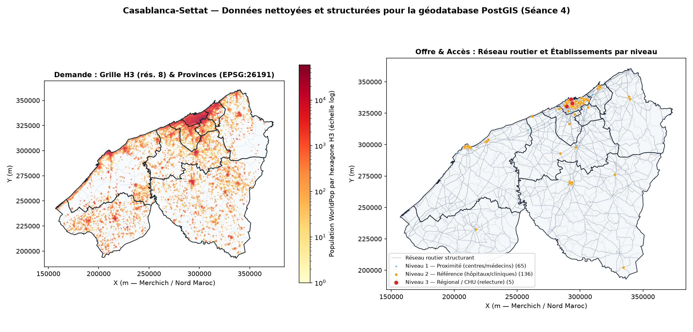

# Phase 2 — Pré-traitement, nettoyage topologique et géodatabase PostGIS (Séance 4)

## 1. Objectif de la phase

Concevoir le modèle conceptuel et logique de données (MCD/MLD), implémenter le schéma PostGIS `sante` avec toutes ses contraintes d'intégrité (`PRIMARY KEY`, `FOREIGN KEY`, `CHECK`, types `geometry(..., 26191)`) et ses index spatiaux (`GIST`) et attributaires (`B-tree`), nettoyer les géométries et la topologie des couches brutes (`nettoyage.py` v2 avec mode `--dry-run`), peupler la géodatabase via `ogr2ogr` → `staging` → `sante`, exécuter et analyser 3 requêtes spatiales métier avec `EXPLAIN (ANALYZE, BUFFERS)`, et produire un dump PostGIS restaurable.

---

## 2. Livrables de la Phase 2 (Séance 4)

| Catégorie | Fichier | Description |
|---|---|---|
| **Support de présentation (Séance 4)** | [`presentation/seance4_pretraitement.pdf`](presentation/seance4_pretraitement.pdf) | Présentation complète de la séance 4 (12 diapositives 16:9, PDF + source Beamer [`.tex`](presentation/seance4_pretraitement.tex)) |
| **Modèle MCD / MLD (Draw.io & PDF)** | [`modelisation_mcd_mld/modele_acces_soins.drawio`](modelisation_mcd_mld/modele_acces_soins.drawio) | Diagramme complet en 3 volets (MCD Merise, MLD relationnel PostGIS, Pipeline) + rapport [`Avancement_projet_MCD_MLD.pdf`](modelisation_mcd_mld/Avancement_projet_MCD_MLD.pdf) |
| **DDL PostGIS complet (`schema.sql`)** | [`sql/schema.sql`](sql/schema.sql) | Schéma `sante` : 8 tables (2 de référence + 6 spatiales en `EPSG:26191`), 10 clés étrangères, contraintes `CHECK`, 6 index `GIST`, 9 index `B-tree` |
| **3 requêtes spatiales métier (`requetes.sql`)** | [`sql/requetes.sql`](sql/requetes.sql) | Jointure spatiale, plus proche voisin KNN `<->` et agrégation spatiale, chacune précédée de `EXPLAIN (ANALYZE, BUFFERS)` |
| **Script de nettoyage v2 (`--dry-run`)** | [`scripts/nettoyage.py`](scripts/nettoyage.py) | Validation géométrique `make_valid`, déduplication topologique point/polygone OSM (< 35 m), découpage du graphe routier aux carrefours partagés, extraction de la composante connexe principale, accrochage au réseau et génération H3 rés. 8 |
| **Script d'import & test PostGIS** | [`scripts/import_postgis.py`](scripts/import_postgis.py) | Création du schéma, import `ogr2ogr`, vérification de 4 rejets par contraintes, exécution de `requetes.sql`, export `pg_dump` et test `pg_restore` |
| **Rapport avant / après nettoyage** | [`preuves/rapport_nettoyage.md`](preuves/rapport_nettoyage.md) | Bilan quantitatif détaillé des corrections géométriques et topologiques par couche |
| **Planche cartographique de nettoyage** | [`preuves/carte_nettoyage.png`](preuves/carte_nettoyage.png) | Visualisation comparative avant/après (déduplication OSM, graphe routier topologique, grille H3, accrochage) |
| **Résultats & plans d'exécution PostGIS** | [`preuves/resultats_requetes_seance4.md`](preuves/resultats_requetes_seance4.md) | Sorties complètes des 3 requêtes métier, plans `EXPLAIN (ANALYZE, BUFFERS)` et preuves de rejet d'insertions invalides |
| **Dump PostGIS restaurable** | [`../sql/acces_soins.backup`](../sql/acces_soins.backup) | Sauvegarde binaire compressée `pg_dump -Fc` (42,13 Mo, restauration vérifiée via `pg_restore`) |
| **Couches nettoyées (GeoPackage)** | [`../donnees_traitees/sante_nettoyee_couches_legeres.gpkg`](../donnees_traitees/sante_nettoyee_couches_legeres.gpkg) | Couches vectorielles nettoyées (`province`, `commune`, `etablissement`, `maille_h3`) en `EPSG:26191` |

---

## 3. Exécution rapide

Depuis la racine du dépôt :

```bash
run_seance4.bat                          # Exécute toute la Phase 2 de bout en bout (Windows)
python scripts/nettoyage.py --dry-run    # Mode rapport seul (aucune écriture dans donnees_traitees/)
python scripts/nettoyage.py              # Nettoyage complet + génération de sante_nettoyee.gpkg
python scripts/import_postgis.py         # Import PostGIS + tests de contraintes + 3 requêtes + pg_dump
```

Pour restaurer directement la géodatabase PostGIS depuis le dump fourni :

```bash
psql -U postgres -c "CREATE DATABASE acces_soins;"
pg_restore -U postgres -d acces_soins --no-owner --no-privileges sql/acces_soins.backup
```

---

## 4. Bilan du nettoyage et du peuplement PostGIS (`EPSG:26191`)

| Table PostGIS (`sante.*`) | Type géométrique (`EPSG:26191`) | Lignes chargées | Principales opérations de nettoyage & topologie |
|---|---|---:|---|
| `sante.type_etablissement` | *(Table de référence)* | **9** | Pondérations métier et niveau de soin (`primaire`, `secondaire`, `tertiaire`, `officine`, `autre`) |
| `sante.classe_route` | *(Table de référence)* | **15** | Classes OSM, vitesses par défaut (20 à 100 km/h) et carrossabilité |
| `sante.province` | `MultiPolygon` | **9** | Union des communes par `code_province` + fermeture de **5 micro-trous d'anneaux** |
| `sante.commune` | `MultiPolygon` | **153** | Jointure RGPH 2024 (153/153, **7 688 967 hab.**), calcul de `superficie_km2` et `densite_hab_km2` |
| `sante.etablissement` | `Point` | **1 583** | Conversion de 227 bâtiments en centroïdes + fusion de **8 doublons topologiques point/polygone OSM (< 35 m)** + accrochage au nœud routier |
| `sante.noeud` | `Point` | **228 554** | Fusion des sommets à `0,1 m` + marquage de la composante connexe principale (**228 022 nœuds**, soit **99,8 %**) |
| `sante.troncon` | `LineString` | **318 229** | Découpage des 130 783 ways OSM aux carrefours partagés, inversion de **294 sens uniques `oneway=-1`**, suppression de **44 boucles** et **4 tronçons dégénérés** |
| `sante.maille_h3` | `MultiPolygon` | **25 255** | Grille hexagonale H3 rés. 8 (~0,74 km²), agrégation WorldPop 100 m (**7 472 060 hab.**), rattachement à la commune et au réseau routier |

---

## 5. Synthèse des 3 requêtes spatiales métier (`sql/requetes.sql`)

| Requête | Opérateurs PostGIS | Index mobilisés (`EXPLAIN ANALYZE`) | Temps d'exécution | Résultat métier clé |
|---|---|---|---:|---|
| **Requête 1 — Jointure spatiale** : offre de soins et ratio p/10 000 hab. par province/commune | `ST_Contains(c.geom, e.geom)` | `etablissement_geom_gist` (`Index Scan`) + `commune_code_prov_idx` | **26,3 ms** | **79 communes sur 153** (878 242 hab.) n'ont **aucun établissement** OSM ; écart de 3,23 (Casablanca) à 0,29 p/10k hab. (Benslimane) |
| **Requête 2 — Plus proche voisin (KNN)** : distance au centre de soins par maille H3 | `e.geom <-> m.geom` (`CROSS JOIN LATERAL`), `ST_Centroid`, `ST_Distance` | `etablissement_geom_gist` (`Index Scan` KNN sur 25 255 hexagones) | **192,4 ms** | **1 088 866 habitants** (14,6 % de la pop. régionale) résident à **plus de 5 km** à vol d'oiseau de tout centre de soins (26,6 km à Benslimane) |
| **Requête 3 — Agrégation spatiale** : desserte routière dans un tampon de 1 km autour des hôpitaux/cliniques | `ST_DWithin(e.geom, t.geom, 1000.0)` | `troncon_geom_gist` (`Bitmap Index Scan` GIST) | **295,6 ms** | **319 hôpitaux/cliniques** analysés ; 98 à 100 % des tronçons riverains sont carrossables à Casablanca/Mohammedia |

---

## 6. Planche de contrôle visuel du nettoyage


